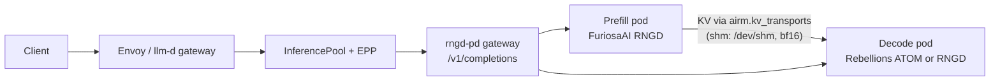

<div align="center">

<h1>rngd-pd</h1>

<h3>FuriosaAI RNGD와 Rebellions ATOM에 걸친 prefill/decode 분리 LLM 서빙</h3>

<p>
  <a href="README.md">English</a> · <strong>한국어</strong>
</p>

<p>
  <a href="https://github.com/ai-computing/ai-rm"></a>
  <a href="https://github.com/ai-computing/rm-core/blob/main/PROTOCOL.md"></a>
  <a href="pyproject.toml"></a>
  
  <a href="deploy/helm/rngd-pd"></a>
  <a href="ai-rm.yaml"></a>
</p>

<p>
  <a href="#-주요-기능"><b>주요 기능</b></a> ·
  <a href="#-빠른-시작"><b>빠른 시작</b></a> ·
  <a href="#-ai-rm-연동"><b>ai-rm 연동</b></a> ·
  <a href="#-결과"><b>결과</b></a> ·
  <a href="#-구조"><b>구조</b></a> ·
  <a href="#-문서"><b>문서</b></a>
</p>

</div>

---

**rngd-pd**는 Llama-3.1-8B의 prefill과 decode를 서로 다른 NPU Pod에서 서빙한다. 프롬프트는 FuriosaAI RNGD
카드에서 prefill하고 Rebellions ATOM 카드(또는 두 번째 RNGD 카드)에서 decode하며, KV 캐시는 vLLM
`KVConnector` 구현을 통해 `/dev/shm`으로 넘긴다. decode 쪽에서 다시 prefill하지 않는다. Pod는 llm-d 뒤에서
동작한다(Envoy → InferencePool → EPP → gateway → prefill/decode Pod).

[**ai-rm**](https://github.com/ai-computing/ai-rm)에서 이 저장소는 L3 PD 서빙 구성요소이며 `shm` KV 전송
(`airm.kv_transports:shm`)과 `rngd-pd` workload runner(`airm.workloads:rngd-pd`)를 제공한다.
**Optimus Prime 엔진의 이전 대상 소스(migration source)**이다
([엔진 통합 계획](https://github.com/ai-computing/ai-rm/blob/master/docs/engine-integration.md)). 통합이 검증될
때까지는 이 저장소가 실행 가능한 PD 서빙 경로로 남는다.

## ✨ 주요 기능

<table>
<tr>
<td width="33%" valign="top">
<b>두 벤더, 한 요청</b><br>
같은 요청을 RNGD prefill이 ATOM decode(또는 RNGD decode)로 넘긴다. decode 쪽은 프롬프트를 재계산하지 않고 전달받은 KV에서 이어서 생성한다.
</td>
<td width="33%" valign="top">
<b>이름으로 고르는 KV 경로</b><br>
connector는 rm-core registry를 통해 <code>AIRM_KV_TRANSPORT</code>로 전송 경로를 고른다. 기본은 <code>shm</code>이고, <code>p2p</code>처럼 복사만 하는 전송은 완료 fence로 감싼다.
</td>
<td width="33%" valign="top">
<b>llm-d 네이티브</b><br>
Helm chart가 prefill, decode, 그리고 기존 InferencePool에 합류하는 OpenAI 형식 gateway를 배포하고, ai-rm 가속기 레이블로 Pod를 배치하며 <code>airm_*</code> 지표를 낸다.
</td>
</tr>
</table>

> [!IMPORTANT]
> **실험 단계.** 알려진 한계:
> - 그래프는 고정 컨텍스트 길이로 컴파일된다. ai-rm 배포에서는 512 토큰(chart 기본값 `seqLen: 256`)이며, 입력+출력이 컴파일 길이를 넘는 요청은 처리할 수 없다.
> - gateway는 **non-streaming** `POST /v1/completions`만 서빙한다.
> - `--chip -1`은 device plugin이 할당한 카드를 쓴다. privileged Pod는 모든 카드를 보므로, 워커는 kubelet device-plugin 체크포인트에서 자기 할당을 읽는다(chart가 읽기 전용으로 마운트하고 `POD_UID`를 넘김). 기록이 없고 카드가 여러 장 보이면 추측하지 않고 멈춘다. 이때 카드는 보이는 카드 중 순번으로 지정된다(`npu2`가 없으면 `npu3`은 `rngd:2`). 런타임이 기대하는 번호이며, `--chip N`도 같은 순번을 받는다.
> - `shm`으로 KV를 넘기려면 prefill과 decode가 같은 노드에 있어야 하며, 단일 노드에서만 검증했다.
> - 독립 컨테이너 이미지는 없다. Pod는 `ubuntu:22.04`에 이 저장소와 호스트 SDK·드라이버를 hostPath로 마운트해 실행한다.
> - 그래프는 호스트에서 미리 컴파일해 `artifacts_cache/`를 채워야 한다.

## 🚀 빠른 시작

NPU 없이 설치·테스트:

```bash
python3 -m pip install --user -e .    # rm-core와 entry point 등록. NPU SDK·vllm은 호스트의 것을 쓴다
export PYTHONPATH=$PWD/src
python -m rm_core.conformance airm.kv_transports shm
python -m pytest -q tests/native_v4 tests/test_airm.py
python -m rngd_pd.connector.transport
python tests/test_connector_tcp.py
helm template deploy/helm/rngd-pd
```

설치하지 않고 `src/`만 `PYTHONPATH`에 둔 경우(Pod)에도 `shm`은 `rngd_pd.airm`에서 직접 찾는다. 다른 전송
이름은 그 이름의 entry point가 설치돼 있어야 한다.

<details>
<summary><b>NPU 호스트에서 커널·엔진·워커 실행</b></summary>
<br>

모든 코드가 `rngd_pd`를 import하므로 `src/`가 경로에 있어야 한다:

```bash
export PYTHONPATH=$PWD/src:$HOME/.local/lib/python3.10/site-packages
export VLLM_PLUGINS=
PY=~/venvs/furiosa/bin/python          # Furiosa SDK가 설치된 Python 환경

# 커널 단독 실행, CPU fp32와 비교 검증
$PY -m rngd_pd.kernels.decode_batch --B 4 --nl 32 --group 2 --chip 2 --validate

# 실제 가중치로 엔진 실행
$PY -m rngd_pd.engines.prefill_full --chip 2 --C 256

# 서빙 워커 (Pod가 실행하는 것)
$PY -m rngd_pd.serving.cluster --role prefill --backend rngd-full --chip 0
```

`cluster.py`의 role은 `prefill`, `decode`, `gateway`, `solo`이고 backend는 `atom`, `rngd`, `rngd-chunk`,
`rngd-full`이다.

bench 스크립트는 `src/`를 스스로 추가하므로 export 없이 실행된다:

```bash
python3 bench/sweep_llmd.py --out bench/sweep_llmd.jsonl
python3 bench/sweep_report.py bench/sweep_llmd.jsonl
```

`bench/kpi_slo.py`, `bench/load_gen.py`, `bench/sweep_llmd.py`는 게이트웨이 변수가 없으면 즉시 오류로
종료한다([ai-rm 연동](#-ai-rm-연동)의 *사이트 설정* 참조).
</details>

<details>
<summary><b>배포</b></summary>
<br>

**Helm (ai-rm).** chart [`deploy/helm/rngd-pd`](deploy/helm/rngd-pd)는 prefill·decode·gateway를 배포하고,
`airm.ai-computing.io/furiosa.RNGD`·`airm.ai-computing.io/rebellions.ATOM` 레이블로 노드를 고르며, KV 경로는
`airm.kvTransport` 값에서 가져온다. 사이트 값(hostPath, 이미지, 모델 아티팩트 경로)은 이 저장소가 아니라 ai-rm
클러스터 override에 넣는다. decode role의 기본값은 ATOM이다. RNGD로 decode하려면 override에서 ATOM 요청도
지워야 한다(`rebellions.ai/ATOM: null`). map merge만으로는 그 요청이 남는다.

**실험 sweep.** sweep 매니페스트는 생성해서 바로 적용한다:

```bash
python3 deploy/k8s/gen_sweep.py > deploy/k8s/sweep-matrix.yaml
kubectl apply -f deploy/k8s/sweep-matrix.yaml
```

Pod는 이 디렉터리를 `/app`에 마운트하고 `python -m rngd_pd.serving.cluster`를 실행한다. Pod당 카드 1장이므로
deployment는 `strategy: Recreate`를 쓴다. rolling update는 한 카드에 Pod 둘을 올리고, 새 Pod가
`allocator != nullptr`로 죽는다. `deploy/k8s/`는 kustomize 형식이 아니다.

그래프는 Pod가 아니라 **호스트에서** 컴파일해야 한다. 컨테이너의 C 컴파일러 단계가 broken pipe로 죽는다.
캐시를 먼저 채운 뒤 Pod를 띄우면 몇 초 안에 로드된다:

```bash
$PY -m rngd_pd.engines.decode_batch --B 4 --group 2 --chip 2
```
</details>

## 🔌 ai-rm 연동

| Entry-point 그룹 | 이름 | 객체 |
|---|---|---|
| `airm.kv_transports` | `shm` | `rngd_pd.airm:ShmTransport` |
| `airm.workloads` | `rngd-pd` | `rngd_pd.airm:run` |

```python
from rm_core import registry
transport = registry.load("airm.kv_transports", "shm")
```

다른 ai-rm 구성요소는 import하지 않고 KV 경로 이름으로만 고른다. 구성 요약은 [`ai-rm.yaml`](ai-rm.yaml)
(계층 `l3-serving`, kind `service`, 성숙도 `experimental`).
**제공**: `Workload`(PD 서빙 경로, runner `rngd-pd`), `KVTransport`(`shm`; vLLM `KVConnectorBase_V1` 구현은
shm/TCP transport를 주입받음), `Metrics`(gateway `airm_*`, 워커 JSON `/metrics`).
**KPI**: MFU·전력효율(`bench/kpi.py`, `bench/sweep_llmd.py`의 보드 전력 샘플링), 이종자원수(RNGD+ATOM 조합),
SLO(`bench/kpi_slo.py`: p99 TPOT 150 ms 달성 비율).

<details>
<summary><b><code>shm</code> 전송</b></summary>
<br>

**`shm`은 host staging 경로다.** KV는 prefill 카드에서 host로 내려와 `/dev/shm` 파일(bf16 wire)로 넘어가고
decode 쪽에서 다시 카드로 올라간다. 장치 간 P2P DMA가 아니다(그것은 hetero-npu-p2p의 `p2p`).

`ShmTransport(root=None)`: `root`는 공유 디렉터리, 기본 `$PD_SHM_ROOT`, 없으면 `/dev/shm/rngd_kv_cluster`.
prefill·decode Pod가 같은 노드의 `/dev/shm`을 마운트해야 한다. host-dram → host-dram(같은 머신)만 지원하고,
dtype은 `bf16`/`fp16`, 양쪽 layout이 같아야 한다. 실패를 다른 경로로 대체하지 않는다.
`conformance_case()`는 같은 호스트의 shm tier 둘을 쓰며, 서빙 디렉터리 대신 옆의 전용 디렉터리에 쓴다.
</details>

<details>
<summary><b>KV 경로 선택</b></summary>
<br>

connector(`rngd_pd/connector/rngd_kv.py`)와 서빙 워커는 `rngd_pd.connector.transport.select_transport()`로
경로를 고른다. 이름은 `AIRM_KV_TRANSPORT`(chart 값 `airm.kvTransport`)이고 기본값은 지금 동작과 같은
`shm`이다. 이름은 `rm_core.registry.load("airm.kv_transports", name)`으로 불러온다.

- connector의 push/pull을 직접 지원하는 구현(`shm`)은 그대로 쓴다.
- tier 사이 복사만 하는 KVTransport(`p2p` 등)는 `FencedTransport`로 감싼다. push는 plan+submit, pull은 완료
  fence(`wait`)가 `ok`일 때만 반환한다. handle이 프로세스 안에 있으므로 prefill과 decode가 한 프로세스
  (hetero-npu-p2p coordinator)에 있어야 한다(Pod가 나뉘면 pull이 timeout된다). connector가 쓰는 바이트는
  프로세스 안에 남고, 감싼 transport는 자기 tier 사이 복사를 fence할 뿐이다.
- 모르는 이름은 `KeyError`다. 구현 클래스는 프로세스당 한 번만 찾는다. rm-core가 import되지 않는 환경에서는
  `shm`만 같은 `/dev/shm` 경로로 동작하고 다른 이름은 `KeyError`다.
- `RngdKVConnector`에 transport를 주입하지 않았을 때 `AIRM_KV_TRANSPORT`(또는 `kv_transport=`, vLLM
  `kv_connector_extra_config["kv_transport"]`)가 있으면 그 경로를, 없으면 예전처럼 in-process를 쓴다.
</details>

<details>
<summary><b>Workload runner <code>run(workload, **config)</code></b></summary>
<br>

`Workload.kind`가 `prefill`이면 RNGD prefill 워커, `decode`면 decode 워커(기본 ATOM), `serve`면 gateway를
`python -m rngd_pd.serving.cluster`로 띄우고 `Popen`을 돌려준다. `Workload.model`은 `MODEL`, decode의
`Workload.batch_hint`는 `--B`가 된다.

| 키 | 기본 | 용도 |
|---|---|---|
| `kv_transport` | `shm` | `airm.kv_transports` 이름, `AIRM_KV_TRANSPORT`로 전달 |
| `port` | `8000` | 워커/게이트웨이 HTTP 포트 |
| `seq_len` | `256` | 그래프를 컴파일한 S |
| `backend` | prefill `rngd-full`, decode `atom` | `cluster.py --backend` |
| `prefill_url`, `decode_url` | 로컬 8101/8102 | gateway가 부를 워커 |
| `metrics_port` | 없음 | gateway의 `airm_*` 포트(`AIRM_METRICS_PORT`) |
| `args`, `env` | 없음 | 추가 `cluster.py` 인자, 추가 환경 변수 |
| `dry_run` | `False` | 실행하지 않고 `(argv, env)` 반환 |
</details>

<details>
<summary><b>지표</b></summary>
<br>

gateway에 `AIRM_METRICS_PORT`가 있으면 그 포트의 `/metrics`에 최근 512요청의 `airm_ttft_p90_ms`,
`airm_tpot_p90_ms`, `airm_tok_s`, `airm_kv_transfer_ms{kv_transport=...}`를 낸다(chart 기본 포트 9400,
어노테이션 `airm.ai-computing.io/scrape: "true"`). `bench/kpi_slo.py` 결과 행에도 같은 이름이 들어간다.

`kv_transfer_ms`는 요청별 `kv_save_ms + kv_load_ms`의 중앙값이다(prefetch가 켜져 있으면 load는 prefill과
겹친다). `power_w`는 아직 `airm_`로 내지 않는다. `bench/kpi.py`의 `power_w`는 구성이 쓴 카드들의 합이라
`scope=card|node` 어느 쪽에도 맞지 않는다.
</details>

<details>
<summary><b>사이트 설정 (<code>cluster.local.env</code>)</b></summary>
<br>

[`cluster.example.env`](cluster.example.env)를 `cluster.local.env`로 복사해 채우고 커밋하지 않는다. 셸에
export한 값이 우선한다.

| 변수 | 필수 | 용도 |
|---|---|---|
| `LLMD_GATEWAY_URL` | 예 (`PD_GATEWAY`가 없을 때) | llm-d 게이트웨이 기본 URL, 예 `http://<gateway-host>:<port>` |
| `PD_GATEWAY` | 아니오 | completions 전체 URL. 설정하면 `LLMD_GATEWAY_URL`보다 우선 |
| `KUBECTL_CMD` | 아니오 | kubectl 실행 방식 (기본 `kubectl`), 예 `ssh -p <ssh-port> <user>@<node-ip> kubectl` |
</details>

## 📊 결과

**ai-rm 종단 간 실행** ([ai-rm docs/e2e.md](https://github.com/ai-computing/ai-rm/blob/master/docs/e2e.md)에서 인용):
Llama-3.1-8B-Instruct, 한 노드에서 RNGD prefill + RNGD decode, KV는 `shm`, 각 1 replica. 요청은 llm-d
gateway를 거쳤고 rm-bench로 측정했다. smoke 워크로드로 연결을 확인한 실행이며 성능 벤치마크가 아니다.

| 시나리오 | 관점 | TTFT p90 | TPOT p90 | KV 전송 p90 | 결과 |
|---|---|---|---|---|---|
| `pd-smoke` (32요청) | 서버 (gateway `airm_*`) | 282 ms | 19.5 ms | 112 ms | SLO PASS, 32/32 |
| Azure 2023 대화 trace 재생 (152요청) | 서버 (gateway `airm_*`) | 179 ms | 17.3 ms | 111 ms | SLO PASS, 오류 0 |

클라이언트 쪽 수치에는 PD 쌍 하나 앞의 대기 시간이 포함된다. 두 관점 모두 링크한 문서에 있다.

<details>
<summary><b>이 저장소에 기록된 개발 중 측정</b></summary>
<br>

[docs/furiosa-request.md](docs/furiosa-request.md) (RNGD 2장, Llama-3.1-8B, 유니크 토큰 프롬프트, 입력 2048, N=16):

| 구성 | 처리량 | ITL p99 |
|---|---|---|
| 복제(DP=2) | 407 tok/s | 87–187 ms |
| PD + decode 카드에서 재프리필 | 263 tok/s (−35%) | 170–226 ms |
| PD + KV 전송 (prefix-cache 에뮬레이션, 전송 무비용 가정의 상한) | 534 tok/s (+31%) | 48–66 ms |

[docs/llmd-usage-and-compat.md](docs/llmd-usage-and-compat.md): resident-KV decode 16.3 ms/token(Llama, argmax
9/9 일치), config 구동 Llama-3.1-8B 14.6 ms/token, Qwen2.5-0.5B 6.4 ms/token. 첫 컴파일은 약 30분, 이후
아티팩트 캐시로 수 초.

수치의 원자료는 `bench/*.jsonl`에 있어 어느 수치든 그것을 만든 sweep까지 추적할 수 있다.
</details>

## 🏗 구조



<details>
<summary><b>저장소 구성</b></summary>
<br>

```
src/rngd_pd/          패키지 — import해서 쓰며 sys.path에 끼워 넣지 않는다
  kernels/            컴파일 그래프: furiosa DSL과 그 위의 torch 모듈
    dsl_b1.py           단일 토큰 decode용 DSL
    dsl_batch.py        배치 폭을 파라미터로 받는 DSL
    prefill_full.py     KV 없는 전체 프롬프트 prefill   (빠른 경로)
    prefill_chunk.py    살아 있는 캐시에 대한 청크 prefill
    decode_batch.py     배치 decode, step당 B 스트림
    decode_resident.py  단일 스트림 decode, 가중치 상주
  engines/            위 그래프에 실제 가중치와 아티팩트 캐시를 붙인 것
    prefill_full.py  decode_batch.py  decode_resident.py  prefill_chunk.py
    model.py            체크포인트 로딩, config, rmsnorm
    artifact_cache.py   그래프 해시 키로 한 번만 컴파일
  vendors/            같은 두 작업의 Rebellions 하드웨어 버전
    rbln_prefill.py  rbln_decode.py  rbln_decode_batch.py
  connector/          KV 핸드오프
    rngd_kv.py          KVConnectorBase_V1 구현
    transport.py        /dev/shm 세그먼트, bf16 wire
  serving/
    cluster.py          prefill / decode / router HTTP 워커
    proxy.py
  airm.py             ai-rm protocol v0.1 adapter (ShmTransport, run)
  paths.py            저장소 루트, 아티팩트 캐시, shm 루트 — 한 곳에서 계산

bench/                측정 진입점 (직접 실행)
deploy/helm/rngd-pd/  ai-rm이 쓰는 Helm chart
deploy/k8s/           gen_sweep.py가 sweep 배포를 생성, 출력을 apply
docs/                 결과 정리와 벤더 요청 문서
attic/                대체된 변형, 참고용으로만 보관
tests/
```

규칙: `kernels/`는 그래프를, `engines/`는 가중치와 캐시를, `serving/`은 HTTP와 llm-d를 안다. 의존성은
아래 방향으로만 흐른다.

`tests/run_selftests.sh`는 예전 디렉터리 구조를 가리키므로 현재는 사용하지 않는다.
</details>

## 📚 문서

| 문서 | 내용 |
|---|---|
| [docs/llmd-usage-and-compat.md](docs/llmd-usage-and-compat.md) | 개요, 사용법, llm-d / vLLM 호환성 매트릭스, 실측 성능 |
| [docs/llmd-integration-plan.md](docs/llmd-integration-plan.md) | 통합 계획과 acceptance 체크리스트 |
| [docs/furiosa-request.md](docs/furiosa-request.md) | FuriosaAI 기술 요청: KV export/import 훅과 컴파일러 이슈 |
| [deploy/README.md](deploy/README.md) | 이전의 컨테이너 / Kubernetes blueprint와 KV 전송 선택 |
| [ROADMAP.md](ROADMAP.md) | 남은 작업 |

일부 문서는 코드가 `src/rngd_pd/`로 옮겨지기 전에 작성되어 예전 `scripts/` 경로를 가리킨다.

## 🗺 로드맵

[ROADMAP.md](ROADMAP.md)와 ai-rm 종단 간 실행에서 나온 남은 항목:

- [x] ai-rm protocol v0.1 adapter: `shm` KVTransport, 이름으로 고르는 KV 경로, workload runner, `airm_*` 지표, Helm chart
- [x] 실 클러스터에서 llm-d를 통한 RNGD + RNGD PD 서빙 ([ai-rm e2e](https://github.com/ai-computing/ai-rm/blob/master/docs/e2e.md))
- [ ] `--chip -1` 대신 device plugin이 배정한 카드 사용
- [ ] ai-rm에서 RNGD → ATOM decode와 live buffer `p2p` 전송을 종단 간 실행
- [ ] 실제 길이 트래픽을 위한 더 긴 컴파일 시퀀스 길이
- [ ] continuous batching 상시 서버, NIXL 전송, Envoy ext-proc EPP
- [ ] Optimus Prime으로 통합 ([계획](https://github.com/ai-computing/ai-rm/blob/master/docs/engine-integration.md))
