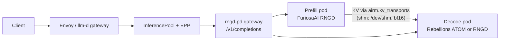

<div align="center">

<h1>rngd-pd</h1>

<h3>Prefill/decode-disaggregated LLM serving across FuriosaAI RNGD and Rebellions ATOM</h3>

<p>
  <strong>English</strong> · <a href="README.ko.md">한국어</a>
</p>

<p>
  <a href="https://github.com/ai-computing/ai-rm"></a>
  <a href="https://github.com/ai-computing/rm-core/blob/main/PROTOCOL.md"></a>
  <a href="pyproject.toml"></a>
  
  <a href="deploy/helm/rngd-pd"></a>
  <a href="ai-rm.yaml"></a>
</p>

<p>
  <a href="#-highlights"><b>Highlights</b></a> ·
  <a href="#-quick-start"><b>Quick start</b></a> ·
  <a href="#-ai-rm-integration"><b>ai-rm integration</b></a> ·
  <a href="#-results"><b>Results</b></a> ·
  <a href="#-architecture"><b>Architecture</b></a> ·
  <a href="#-documentation"><b>Docs</b></a>
</p>

</div>

---

**rngd-pd** serves Llama-3.1-8B with prefill and decode on separate NPU pods: the prompt is prefilled on a
FuriosaAI RNGD card and decoded on a Rebellions ATOM card (or a second RNGD card), with the KV cache handed
over through a vLLM `KVConnector` implementation over `/dev/shm`. Nothing is re-prefilled on the decode side.
The pods run behind llm-d (Envoy → InferencePool → EPP → gateway → prefill/decode pods).

In [**ai-rm**](https://github.com/ai-computing/ai-rm) it is the L3 PD-serving component and provides the
`shm` KV transport (`airm.kv_transports:shm`) and the `rngd-pd` workload runner (`airm.workloads:rngd-pd`).
It is a **migration source for the Optimus Prime engine**
([engine consolidation plan](https://github.com/ai-computing/ai-rm/blob/master/docs/engine-integration.md)):
until that consolidation is validated, this repository remains the executable PD-serving path.

Compiled-variant swapping: [`rngd_pd.swap`](docs/delta-swap.md) keeps RNGD weights resident
and selects co-compiled ATOM decoders, with an optional background warm pool.

## ✨ Highlights

<table>
<tr>
<td width="33%" valign="top">
<b>Two vendors, one request</b><br>
RNGD prefill feeds ATOM decode (or RNGD decode) for the same request; the decode side continues from the transferred KV instead of recomputing the prompt.
</td>
<td width="33%" valign="top">
<b>KV path by name</b><br>
The connector picks its transport with <code>AIRM_KV_TRANSPORT</code> through the rm-core registry. <code>shm</code> is the default; copy-only transports such as <code>p2p</code> are wrapped with a completion fence.
</td>
<td width="33%" valign="top">
<b>llm-d native</b><br>
A Helm chart deploys prefill, decode and an OpenAI-style gateway that joins an existing InferencePool, places pods by ai-rm accelerator labels and exports <code>airm_*</code> metrics.
</td>
</tr>
</table>

> [!IMPORTANT]
> **Experimental.** Known limits:
> - Graphs are compiled for a fixed context length: 512 tokens in the ai-rm deployment (chart default `seqLen: 256`). Requests with input + output above the compiled length do not fit.
> - The gateway serves only **non-streaming** `POST /v1/completions`.
> - `--chip -1` uses the card the device plugin allocated. A privileged pod sees every card, so the worker reads its allocation from the kubelet device-plugin checkpoint (the chart mounts it read-only and passes `POD_UID`); without that record and with several cards visible it stops instead of guessing. The card is then addressed by its position among the visible cards (`rngd:2` for `npu3` when `npu2` is absent), which is what the runtime expects; `--chip N` takes that ordinal too.
> - KV over `shm` needs prefill and decode on the same node. Across nodes use `tcp` (below): verified byte- and token-exact through a relay on a CPU node, but NPU to NPU on two NPU nodes has not run, and at 1 GbE each 67 MB handoff takes ~0.8 s.
> - There is no standalone container image: pods run `ubuntu:22.04` with this repository and the host SDK and drivers mounted by hostPath.
> - Graphs must be compiled on the host beforehand to fill `artifacts_cache/`.

## 🚀 Quick start

Install and test without an NPU:

```bash
python3 -m pip install --user -e .    # rm-core and the entry points; the NPU SDKs and vllm come from the host
export PYTHONPATH=$PWD/src
python -m rm_core.conformance airm.kv_transports shm
python -m pytest -q tests/native_v4 tests/test_airm.py
python -m rngd_pd.connector.transport
python tests/test_connector_tcp.py
python -m pytest -q tests/test_kv_tcp.py      # tcp transport, relay server, conformance
python -m pytest -q tests/test_kv_ucx.py      # nixl-ucx (fake NIXL; real NIXL + UCX where installed)
helm template deploy/helm/rngd-pd
```

Without installing (only `src/` on `PYTHONPATH`, as in the pods), `shm` is still found directly in
`rngd_pd.airm`; any other transport name needs its entry point installed.

<details>
<summary><b>Run kernels, engines and workers on an NPU host</b></summary>
<br>

Everything imports `rngd_pd`, so `src/` has to be on the path:

```bash
export PYTHONPATH=$PWD/src:$HOME/.local/lib/python3.10/site-packages
export VLLM_PLUGINS=
PY=~/venvs/furiosa/bin/python          # the Python environment with the Furiosa SDK

# a kernel on its own, checked against CPU fp32
$PY -m rngd_pd.kernels.decode_batch --B 4 --nl 32 --group 2 --chip 2 --validate

# an engine with real weights
$PY -m rngd_pd.engines.prefill_full --chip 2 --C 256

# a serving worker (this is what the pods run)
$PY -m rngd_pd.serving.cluster --role prefill --backend rngd-full --chip 0
```

`cluster.py` roles are `prefill`, `decode`, `gateway` and `solo`; backends are `atom`, `rngd`, `rngd-chunk`
and `rngd-full`.

Bench scripts add `src/` themselves, so they run without the export:

```bash
python3 bench/sweep_llmd.py --out bench/sweep_llmd.jsonl
python3 bench/sweep_report.py bench/sweep_llmd.jsonl
```

`bench/kpi_slo.py`, `bench/load_gen.py` and `bench/sweep_llmd.py` exit immediately if no gateway variable is
set (see *Site configuration* under [ai-rm integration](#-ai-rm-integration)).
</details>

<details>
<summary><b>Deploy</b></summary>
<br>

**Helm (ai-rm).** The chart [`deploy/helm/rngd-pd`](deploy/helm/rngd-pd) deploys prefill, decode and gateway,
selects nodes by `airm.ai-computing.io/furiosa.RNGD` and `airm.ai-computing.io/rebellions.ATOM` labels and takes
the KV path from `airm.kvTransport`. Site values (hostPaths, image, model artifact paths) go in an ai-rm cluster
override, never in this repository. The decode role defaults to ATOM; to decode on RNGD, also remove the ATOM
request in the override (`rebellions.ai/ATOM: null`), because a map merge keeps it.

**Experiment sweeps.** The sweep manifests are generated, then the node name and home directory
(`${RNGD_PD_NODE}`, `${RNGD_PD_HOME}`, set in `cluster.local.env`) are filled in when applying:

```bash
python3 deploy/k8s/gen_sweep.py > deploy/k8s/sweep-matrix.yaml
python3 deploy/k8s/render.py deploy/k8s/sweep-matrix.yaml | kubectl apply -f -
```

Pods mount this directory at `/app` and run `python -m rngd_pd.serving.cluster`. One card per pod, so
deployments use `strategy: Recreate`: a rolling update puts two pods on one card and the new one dies with
`allocator != nullptr`. `deploy/k8s/` is not a kustomize directory.

Graphs must be compiled **on the host**, not in the pod: the container's C compiler stage dies with a broken
pipe. Warm the cache first, then start the pod, which will load in seconds:

```bash
$PY -m rngd_pd.engines.decode_batch --B 4 --group 2 --chip 2
```
</details>

## 🔌 ai-rm integration

| Entry-point group | Name | Object |
|---|---|---|
| `airm.kv_transports` | `shm` | `rngd_pd.airm:ShmTransport` |
| `airm.kv_transports` | `tcp` | `rngd_pd.airm:TcpTransport` |
| `airm.kv_transports` | `nixl` | `rngd_pd.kv_nixl:NixlTransport` |
| `airm.kv_transports` | `nixl-ucx` | `rngd_pd.airm:NixlUcxTransport` |
| `airm.workloads` | `rngd-pd` | `rngd_pd.airm:run` |

```python
from rm_core import registry
transport = registry.load("airm.kv_transports", "shm")
```

Other ai-rm components are never imported; the KV path is selected only by name. Configuration summary:
[`ai-rm.yaml`](ai-rm.yaml) (layer `l3-serving`, kind `service`, maturity `experimental`).
**Provides** `Workload` (PD serving, runner `rngd-pd`), `KVTransport` (`shm`; the vLLM `KVConnectorBase_V1`
implementation takes an injected shm/TCP transport) and `Metrics` (gateway `airm_*`, worker JSON `/metrics`).
**KPIs**: MFU and power efficiency (`bench/kpi.py`, board power sampling in `bench/sweep_llmd.py`),
heterogeneous resource count (RNGD + ATOM), SLO (`bench/kpi_slo.py`: share of requests within p99 TPOT 150 ms).

<details>
<summary><b><code>shm</code> transport</b></summary>
<br>

**`shm` is a host-staging path.** KV comes down from the prefill card to the host, crosses as a `/dev/shm` file
(bf16 wire) and is uploaded again on the decode side. It is not device-to-device P2P DMA (that is `p2p` in
hetero-npu-p2p).

`ShmTransport(root=None)`: `root` is the shared directory, by default `$PD_SHM_ROOT`, otherwise
`/dev/shm/rngd_kv_cluster`. Prefill and decode pods must mount the same node's `/dev/shm`. Only host-dram →
host-dram on the same machine is supported, dtype `bf16`/`fp16`, with identical layouts on both sides. Failures
are not replaced by another path. `conformance_case()` uses two shm tiers on the same host and writes to a
dedicated directory next to the serving one.
</details>

<details>
<summary><b><code>tcp</code> transport (cross-node)</b></summary>
<br>

**`tcp` is host staging over the network.** The prefill worker pushes each layer's K and V (bf16 wire, 1 MiB blobs at
S=512) to a `TcpKVServer` ([`connector/tcpkv.py`](src/rngd_pd/connector/tcpkv.py), standard library only); the decode
worker takes them from it, the server waiting for a blob that has not arrived yet. Connections are pooled per process,
and each blob carries a CRC-32 checked by the server and the receiver (`AIRM_KV_TCP_CRC=0` skips it). The server is
named by `AIRM_KV_TCP_ADDR=host:port`; the chart's `kvRelay` runs it as a relay pod on any node (a CPU node is enough)
and sets the address for the workers. With a relay on a third node both legs cross the network; a server next to the
decode worker makes the pull local. `AIRM_KV_TCP_LOG=1` logs size and SHA-256 per blob for audits.

Measured on the cluster (ai-rm [baselines](https://github.com/ai-computing/ai-rm/blob/master/docs/baselines.md),
RNGD prefill and RNGD decode on the NPU node, relay on a CPU node, 1 GbE): 2,112 of 2,112 blobs identical on both ends,
the same output as `shm` for 32 of 32 requests; 67 MB per request in 758 ms (push) and 832 ms (pull) one at a time,
0.117 GB/s per direction with 8 in flight (the NIC's line rate). `bench/kv_tcp_bench.py` measures it.
</details>

<details>
<summary><b><code>nixl-ucx</code> transport (cross-node, RDMA-ready)</b></summary>
<br>

**`nixl-ucx` is host staging with NIXL's UCX backend carrying the bytes.** It is the cross-node path that becomes RDMA
by configuration ([ai-rm#46](https://github.com/ai-computing/ai-rm/issues/46)). The prefill worker copies each blob into
a host arena registered with NIXL once and publishes a ~400-byte descriptor (agent metadata, address, length, CRC-32)
under the blob's key in the same `TcpKVServer` the `tcp` transport uses (`AIRM_KV_TCP_ADDR`, chart `kvRelay`). The decode
worker takes the descriptor and pulls the bytes with a one-sided NIXL READ into its own registered arena
([`connector/ucxkv.py`](src/rngd_pd/connector/ucxkv.py)); the READ's notification frees the prefill slot (unread slots
expire after `AIRM_KV_TCP_TTL_S`). The prefill process must stay up until decode has read. A failed READ or a CRC
mismatch raises; nothing falls back to another path.

The wire is UCX's choice from its environment, so the code does not change between today and RDMA:

| Network | Setting |
|---|---|
| today, no RDMA device | `UCX_TLS=tcp` (`UCX_TCP_TX/RX_SEG_SIZE` default to 64 KiB here) |
| RoCE v2 / InfiniBand NIC, or soft-RoCE (`rdma_rxe`) | `UCX_TLS=rc,ud,sm,self`, `UCX_NET_DEVICES=<mlx5_0:1 / irdma0:1 / rxe0:1>` |

Needs `nixl` with the UCX plugin importable by the workers (the `nixl` + `nixl-cu12` 1.5.0 wheels; the plugin and UCX
are bundled, CUDA is not needed: `pip install --no-deps nixl==1.5.0 nixl-cu12==1.5.0 numpy`). Arena size per side:
`AIRM_KV_UCX_POOL_MB` (1024). `AIRM_KV_UCX_LOG=1` logs size and SHA-256 per blob. `python -m rngd_pd.connector.ucxkv`
prints what the host's NIXL/UCX would use.

Measured 2026-10-21 (`bench/kv_ucx_bench.py`: 67.1 MB per request at S=512, 64 blobs, a pod on the NPU node pushing to
a pod on a CPU node, the server beside decode, 1 GbE, `UCX_TLS=tcp`, SHA-256 per blob):

| | 1 in flight, one way | 8 in flight, both runs |
|---|--:|--:|
| `nixl-ucx`, run 1 / run 2 | 790 / 920 ms (0.085 / 0.073 GB/s) | 0.100 / 0.076 GB/s |
| `tcp`, same pods, run 1 / run 2 | 780 / 996 ms (0.086 / 0.067 GB/s) | 0.097 / 0.090 GB/s |

All 8,192 blobs (both runs) byte-exact. Over 1 GbE both are link-bound and equal within the run-to-run spread; run 2 shared the link
with other jobs. Without the link (two processes in one pod) a request moves at 0.44 GB/s with `nixl-ucx` over UCX-TCP
and 0.55 GB/s with `tcp`, so on a 10 GbE link without RDMA use `tcp` until `nixl-ucx` is measured there; the gain of
`nixl-ucx` is RDMA. Not yet run: serving with NPU workers on `nixl-ucx` (token-exact check) and any RDMA transport (no
RDMA device on the NPU nodes, ai-rm#46). With the `nixl_cu12` wheel, a worker process that imported vLLM's KV connector
before creating the agent loads two rdma-core copies and segfaults in libnl's exit handler when it exits (after the work
is done); the tests keep real agents in child processes.
</details>

<details>
<summary><b><code>nixl</code> transport (RNGD → ATOM over NIXL)</b></summary>
<br>

`rngd_pd.kv_nixl.NixlTransport` moves one request's KV between live allocations through NIXL and
hetero-npu-p2p's `HETERO_NPU` backend plugin ([docs/nixl-backend.md](https://github.com/ai-computing/hetero-npu-p2p/blob/master/docs/nixl-backend.md)).
The caller binds the allocations for each request (`bind(request_id, NixlBinding(src, dst, context))`), then runs
`plan` → `submit` → `wait`. `wait` is the completion fence: it returns once every DMA command of the request has
completed.

| Route | Source → destination | Data path |
|---|---|---|
| `rngd → dmabuf` | RNGD device DRAM → exported ATOM DMA-BUF | **direct** PCIe P2P, no host memory |
| `rngd → host` | RNGD device DRAM → pinned host pages | explicit staging leg |
| `host → rngd` | pinned host pages → RNGD device DRAM | explicit staging leg |
| RNGD → RNGD, ATOM → anything, host → host | — | refused at `plan()`. For RNGD → RNGD, plan the two staging legs yourself |

The layout is rngd-pd's: K `[layers, kv_heads, head_dim, S]` and V `[layers, kv_heads, S, head_dim]`, bf16, S wide.
The transport copies bytes and never converts them, and it never falls back to another path. The backend allows
one agent on one host, so the process that owns the agent must see the RNGD tensor (`data_ptr()`, PE0 device path)
and hold the ATOM DMA-BUF fds (passed with `SCM_RIGHTS` if another process allocated them).

**The serving pods still use `shm`.** `AIRM_KV_TRANSPORT=nixl` selects this transport through `FencedTransport`
like `p2p`, and its host-tier push fails with `TransportError`. The serving prefill worker downloads KV to the host,
and the ATOM decode graph takes the whole cache as a host input on every step, so neither side holds a device
buffer the transport could fill. The engine-side need is filed on
[aicomp#48](https://github.com/ai-computing/aicomp/issues/48).

**Verified on the node** with `bench/nixl_kv_check.py` and `bench/nixl_decode_tokens.py`, run in one pod with 2
RNGD cards and 1 ATOM card (Llama-3.1-8B, S=512, 5 prompts of 6–471 tokens, 67.1 MB of KV each):

| | Time per request | Bytes |
|---|--:|---|
| `shm` (serving path): device download + `/dev/shm` load at the decode side | 14–17 ms + 26–32 ms | — |
| `nixl` RNGD → ATOM DMA-BUF (direct, queue depth 4) | **1.63 ms** (~41 GB/s) | equal to the source and to the `shm` payload, 5/5 |
| `nixl` RNGD → host (staging leg) | 10–14 ms | equal, 5/5 |
| `nixl` host → second RNGD (staging leg; with the leg above, RNGD → RNGD) | 12–15 ms | equal (SDK readback), 5/5 |

ATOM decode (B=1 graph, 32 tokens) from the KV that crossed RNGD → ATOM gave the same tokens as from the `shm`
KV, 5/5 prompts. The cache was read back from the ATOM buffer first (see above).
</details>

<details>
<summary><b>KV path selection</b></summary>
<br>

The connector (`rngd_pd/connector/rngd_kv.py`) and the serving workers choose the path with
`rngd_pd.connector.transport.select_transport()`. The name comes from `AIRM_KV_TRANSPORT` (chart value
`airm.kvTransport`); the default is `shm`, the current behaviour. Names are loaded with
`rm_core.registry.load("airm.kv_transports", name)`.

- Implementations that support the connector's push/pull directly (`shm`) are used as they are.
- KVTransports that only copy between tiers (`p2p` and others) are wrapped in `FencedTransport`: push is
  plan + submit, pull returns only when the completion fence (`wait`) is `ok`. The handle lives in the process,
  so prefill and decode must be in one process (the hetero-npu-p2p coordinator); with split pods, pull times out.
  The bytes the connector writes stay in the process; the wrapped transport only fences copies between its tiers.
- An unknown name raises `KeyError`. The implementation class is looked up once per process. Where rm-core cannot
  be imported, only `shm` works (same `/dev/shm` path) and other names raise `KeyError`.
- If no transport is injected into `RngdKVConnector`, `AIRM_KV_TRANSPORT` (or `kv_transport=`, or vLLM
  `kv_connector_extra_config["kv_transport"]`) selects the path; without any of these it stays in-process as before.
</details>

<details>
<summary><b>Workload runner <code>run(workload, **config)</code></b></summary>
<br>

`Workload.kind` `prefill` starts an RNGD prefill worker, `decode` a decode worker (ATOM by default) and `serve`
the gateway, each as `python -m rngd_pd.serving.cluster`; it returns the `Popen`. `Workload.model` becomes
`MODEL`, and for decode `Workload.batch_hint` becomes `--B`.

| Key | Default | Purpose |
|---|---|---|
| `kv_transport` | `shm` | `airm.kv_transports` name, passed as `AIRM_KV_TRANSPORT` |
| `port` | `8000` | Worker / gateway HTTP port |
| `seq_len` | `256` | S the graphs were compiled for |
| `backend` | prefill `rngd-full`, decode `atom` | `cluster.py --backend` |
| `prefill_url`, `decode_url` | local 8101/8102 | Workers the gateway calls |
| `metrics_port` | none | Gateway `airm_*` port (`AIRM_METRICS_PORT`) |
| `args`, `env` | none | Extra `cluster.py` arguments, extra environment variables |
| `dry_run` | `False` | Return `(argv, env)` instead of running |
</details>

<details>
<summary><b>Metrics</b></summary>
<br>

With `AIRM_METRICS_PORT` set, the gateway exports on that port's `/metrics`, over the most recent 512 requests,
`airm_ttft_p90_ms`, `airm_tpot_p90_ms`, `airm_tok_s` and `airm_kv_transfer_ms{kv_transport=...}` (chart default
port 9400, annotation `airm.ai-computing.io/scrape: "true"`). Result rows of `bench/kpi_slo.py` use the same names.

`kv_transfer_ms` is the median of per-request `kv_save_ms + kv_load_ms` (with prefetch on, load overlaps
prefill). `power_w` is not exported as `airm_` yet: `power_w` in `bench/kpi.py` is the sum over the cards a
configuration uses, which matches neither `scope=card` nor `scope=node`.
</details>

<details>
<summary><b>Site configuration (<code>cluster.local.env</code>)</b></summary>
<br>

Copy [`cluster.example.env`](cluster.example.env) to `cluster.local.env`, fill it in and never commit it.
Variables already exported in the shell take precedence.

| Variable | Required | Purpose |
|---|---|---|
| `LLMD_GATEWAY_URL` | yes (unless `PD_GATEWAY` is set) | llm-d gateway base URL, e.g. `http://<gateway-host>:<port>` |
| `PD_GATEWAY` | no | Full completions URL; overrides `LLMD_GATEWAY_URL` |
| `KUBECTL_CMD` | no | How to run kubectl (default `kubectl`), e.g. `ssh -p <ssh-port> <user>@<node-ip> kubectl` |
| `RNGD_PD_NODE`, `RNGD_PD_HOME` | for `deploy/k8s/render.py` | Node the experiment pods are pinned to, and the home directory whose Python trees they mount |
</details>

## 📊 Results

**ai-rm end-to-end run** (from [ai-rm docs/e2e.md](https://github.com/ai-computing/ai-rm/blob/master/docs/e2e.md)):
Llama-3.1-8B-Instruct, RNGD prefill + RNGD decode on one node, KV over `shm`, one replica each, requests through
the llm-d gateway and measured by rm-bench. This was a connectivity run with a smoke workload, not a
performance benchmark.

| Scenario | View | TTFT p90 | TPOT p90 | KV transfer p90 | Result |
|---|---|---|---|---|---|
| `pd-smoke` (32 requests) | Server (gateway `airm_*`) | 282 ms | 19.5 ms | 112 ms | SLO PASS, 32/32 |
| Azure 2023 conversation trace replay (152 requests) | Server (gateway `airm_*`) | 179 ms | 17.3 ms | 111 ms | SLO PASS, 0 errors |

Client-side figures include queueing in front of a single PD pair; see the linked page for both views.

<details>
<summary><b>Development measurements recorded in this repository</b></summary>
<br>

From [docs/furiosa-request.md](docs/furiosa-request.md) (2 × RNGD, Llama-3.1-8B, unique-token prompts,
input 2048, N=16):

| Configuration | Throughput | ITL p99 |
|---|---|---|
| Replication (DP=2) | 407 tok/s | 87–187 ms |
| PD with re-prefill on the decode card | 263 tok/s (−35%) | 170–226 ms |
| PD with KV transfer (prefix-cache emulation; upper bound assuming free transfer) | 534 tok/s (+31%) | 48–66 ms |

From [docs/llmd-usage-and-compat.md](docs/llmd-usage-and-compat.md): resident-KV decode at 16.3 ms/token
(Llama, 9/9 argmax match), config-driven Llama-3.1-8B at 14.6 ms/token and Qwen2.5-0.5B at 6.4 ms/token;
first compile about 30 minutes, then seconds from the artifact cache.

The raw runs behind the figures are in `bench/*.jsonl`, so any number can be traced to the sweep that produced it.
</details>

### Compiled variant swapping

The opt-in [`rngd_pd.swap` API](docs/delta-swap.md) keeps RNGD weights resident
and selects ATOM decoders compiled in one shared session. Measured engine
request-to-first-token latency on the specified 8B checkpoints:

| Change | Full reload | Retained/prepared path |
|---|---:|---:|
| RNGD B4/B8, S256/S512 | 20.6–23.5 s | 0.25–0.45 s |
| RNGD changed 117 MB projection, precomputed ranges | 22.43 s | 0.947 s |
| ATOM co-compiled B1/B8, S512 | 19.6–20.3 s | 0.071–0.564 s |

All compared generated token IDs equal fresh destination loads. Independent
ATOM builds need another weight copy; a 0.5B warm-pool test selected the prepared
bundle through its first token in 10 ms, but preparation delayed a concurrent
request by 1.44 s. See the [experiment, versions, commands and limits](experiments/2026-10-22-delta-swap.md).
The default cluster worker and in-flight KV are not automatically migrated.

## 🏗 Architecture



<details>
<summary><b>Repository layout</b></summary>
<br>

```
src/rngd_pd/          the package — imported, never sys.path-injected
  kernels/            compiled graphs: furiosa DSL + the torch modules on top
    dsl_b1.py           DSL for single-token decode
    dsl_batch.py        DSL parameterised by batch width
    prefill_full.py     kv-free whole-prompt prefill   (the fast one)
    prefill_chunk.py    chunked prefill against a live cache
    decode_batch.py     batched decode, B streams per step
    decode_resident.py  single-stream decode, weights resident
  engines/            those graphs with real weights and an artifact cache
    prefill_full.py  decode_batch.py  decode_resident.py  prefill_chunk.py
    model.py            checkpoint loading, config, rmsnorm
    artifact_cache.py   compile once, keyed by graph hash
  vendors/            the same two jobs on Rebellions hardware
    rbln_prefill.py  rbln_decode.py  rbln_decode_batch.py
  connector/          KV handoff
    rngd_kv.py          KVConnectorBase_V1 implementation
    transport.py        /dev/shm segments, bf16 wire
  serving/
    cluster.py          prefill / decode / router HTTP workers
    proxy.py
  airm.py             ai-rm protocol v0.1 adapter (ShmTransport, run)
  kv_nixl.py          `nixl` KVTransport over NIXL + HETERO_NPU (RNGD -> ATOM DMA-BUF, staging legs)
  paths.py            repo root, artifact cache, shm root — worked out once

bench/                measurement entry points (run directly)
deploy/helm/rngd-pd/  Helm chart used by ai-rm
deploy/k8s/           gen_sweep.py emits the sweep deployment; apply the output
docs/                 findings and vendor correspondence
attic/                superseded variants, kept for reference only
tests/
```

The rule: `kernels/` knows about graphs, `engines/` knows about weights and caching, `serving/` knows about
HTTP and llm-d. Dependencies point downward.

`tests/run_selftests.sh` still points at the old directory layout and is currently unused.
</details>

## 📚 Documentation

| Document | Content |
|---|---|
| [docs/llmd-usage-and-compat.md](docs/llmd-usage-and-compat.md) | Overview, usage, llm-d / vLLM compatibility matrix and measured performance (Korean) |
| [docs/llmd-integration-plan.md](docs/llmd-integration-plan.md) | Integration plan and acceptance checklist (Korean) |
| [docs/furiosa-request.md](docs/furiosa-request.md) | Technical request to FuriosaAI: KV export/import hook and compiler issues (Korean) |
| [deploy/README.md](deploy/README.md) | Earlier container / Kubernetes blueprint and KV transport choices (Korean) |
| [ROADMAP.md](ROADMAP.md) | Remaining work (Korean) |

Some of these documents were written before the code moved into `src/rngd_pd/` and still refer to the
earlier `scripts/` paths.

## 🗺 Roadmap

Open items from [ROADMAP.md](ROADMAP.md) and the ai-rm end-to-end run:

- [x] ai-rm protocol v0.1 adapter: `shm` KVTransport, KV path by name, workload runner, `airm_*` metrics, Helm chart
- [x] RNGD + RNGD PD serving through llm-d on the live cluster ([ai-rm e2e](https://github.com/ai-computing/ai-rm/blob/master/docs/e2e.md))
- [x] Use the card the device plugin allocated, also in privileged pods
- [ ] RNGD → ATOM decode and the `p2p` transport with live buffers end to end under ai-rm
- [ ] Larger compiled sequence lengths for real-length traffic
- [x] `nixl` KV transport over hetero-npu-p2p's HETERO_NPU backend (RNGD → ATOM DMA-BUF direct, RNGD ↔ host legs); byte- and token-exact on the node
- [ ] Serving pods on `nixl`: device-resident KV on both sides ([aicomp#48](https://github.com/ai-computing/aicomp/issues/48))
- [ ] Always-on server with continuous batching; Envoy ext-proc EPP
- [ ] Consolidation into Optimus Prime ([plan](https://github.com/ai-computing/ai-rm/blob/master/docs/engine-integration.md))
