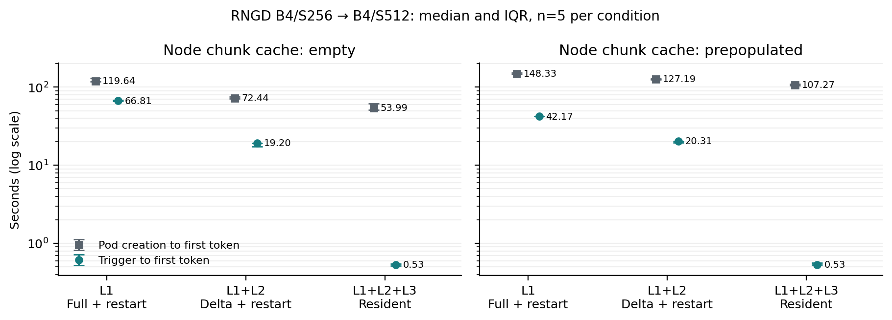
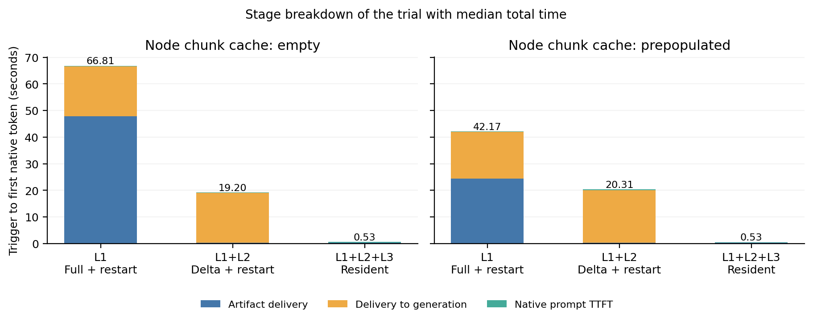

# E6: matched RNGD reconfiguration, n=5 per condition

Thirty independent Kubernetes Jobs completed; all30 are valid. The three
n=1 smoke trials are retained separately and excluded from these statistics.
Every target continuation (32 integer token IDs per trial) equals an
independently fresh-loaded B4/S512 reference. Compilation attempts:0.

SDK2026.4.0, Torch2.10.0+cpu, Llama-3.1-8B, B4/S256→B4/S512, group2,
host_workers2, intra-op4, physical RNGD card0. Executed benchmark source:
`530195d121f3ced24f0761a7d9de646810fa0dee`.

| Node chunk cache at trigger | Arm | n | Pod creation→first token, s | Trigger→first token, s |
|---|---|---:|---:|---:|
| empty | full | 5 | 119.637 (10.863) | 66.807 (1.856) |
| empty | delta | 5 | 72.435 (3.288) | 19.199 (1.925) |
| empty | resident | 5 | 53.993 (10.127) | 0.532 (0.033) |
| prepopulated | full | 5 | 148.327 (6.325) | 42.169 (0.546) |
| prepopulated | delta | 5 | 127.188 (3.132) | 20.312 (0.829) |
| prepopulated | resident | 5 | 107.266 (3.501) | 0.530 (0.033) |

Values are median (IQR); quartiles use inclusive linear interpolation.

- `full`: whole artifact pull, close/exit the base worker, start a new target worker.
- `delta`: actual base-aware pull/apply, then the same worker restart.
- `resident`: the same delta delivery, retain all113 shared projection/LM
  buffers and the base graph modules, prepare the target variant in that process.

The resident target constructor/shared-weight-upload phases are0: their cost
was paid during the common initial base load and remains in Pod time. Target
programs, constants, tables and prompt processing still take time. Other arms
perform one additional full shared-weight upload in the new target process.

Empty node-cache full pulls read10,702,211,666 compressed payload bytes from
the colocated POSIX store per trial; delta/resident read197,911 and reuse
16,060,805,278 logical base bytes. Prepopulated store-read counters are0 for
all three arms. Store payload bytes and logical reused bytes have different
meanings; these counters are not physical network or DMA measurements.

Reproduction and evidence:

- [Raw-linked collection](e6-collection.json), [all values/median/IQR](e6-summary.json),
  [frozen order](e6-frozen-matrix-plan.json), [raw index](publication-index.json).
- [Preparation/source/input proof](preparation.json) and
  [actual Job policy observation](e6-actual-job-policy-observation.json).
- Every public sample retains original private-result SHA256, source, input,
  Pod identity, native counters, tokens, physical assignment and verified cleanup.
- Run `python bench/ccgrid_summary.py experiments/data/ccgrid-npu-20261030/e6-collection.json --out NEW.json`.
- With Matplotlib installed, run `python experiments/data/ccgrid-npu-20261030/figures/plot_e6.py`.

[TTFT PDF](figures/e6-ttft.pdf) · [phase PDF](figures/e6-trigger-phases.pdf) ·
[figure provenance](figures/provenance.json). Phase bars use the actual trial
with median total, so their segments add exactly to that total; they are not
sums of unrelated marginal component medians.

Scope: native decode, colocated POSIX delivery, existing precompiled target
graphs used for the first time in each trial. OS page cache and background
node load are uncontrolled. Node-cache priming, base copy/load and ephemeral
Ubuntu dependency bootstrap count in Pod time; SDK files are fixed/read-only.
Pod clocks use actual API timestamps and synchronized hosts, with no measured
pairwise skew bound. The monotonic trigger clock stays on one host.
`upload_weights_s` includes CPU layout and H2D. This is not an HTTP/live gateway
benchmark or a claim about startup of a prebuilt production serving image.
Token-ID equality does not establish dense-logit bitwise equality.

The paper session owns `NUMBERS.md`; it is unchanged by this publication.
